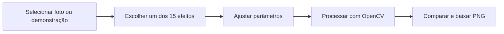
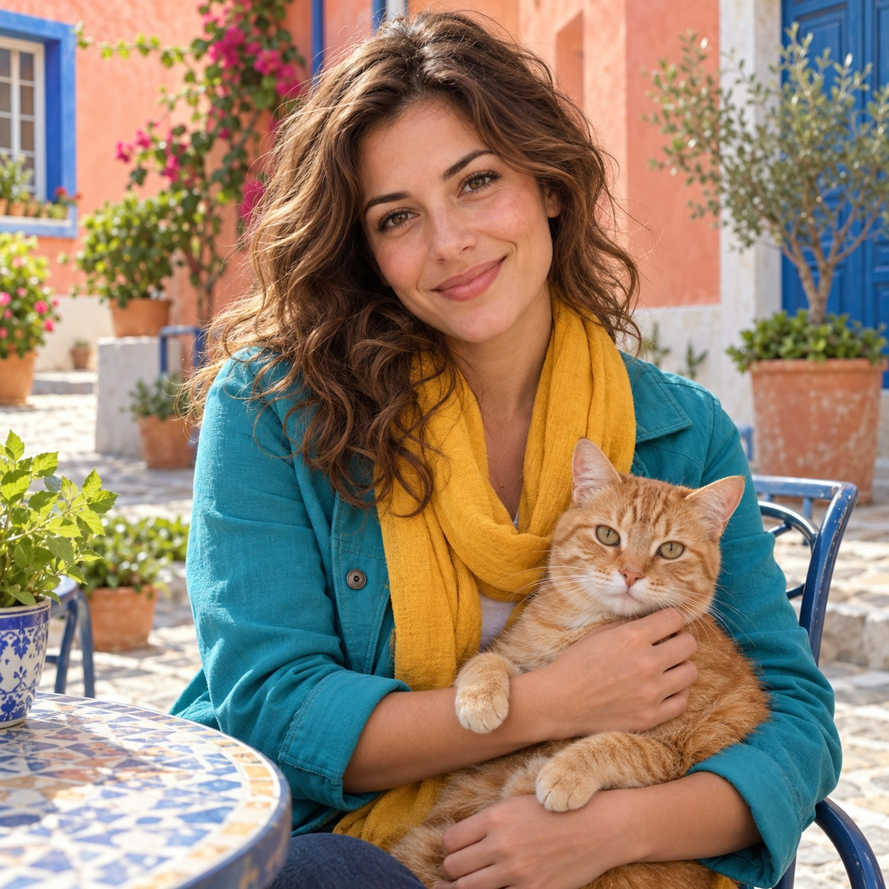

# FotoImagem · Foto → Desenho

Aplicação interativa em Python para transformar fotos em desenhos, contornos e estilos de pintura. Compare a imagem original com o resultado, ajuste os controles e baixe a criação em PNG.

## Acesse o aplicativo

**[Experimentar FotoImagem no Render](https://fotoimagem.onrender.com)** — versão pública conectada à branch `main` deste repositório. No plano gratuito do Render, o primeiro acesso após um período de inatividade pode levar mais tempo.


### Visão rápida

| Entrada | Processamento | Resultado |
|---|---|---|
| Fotografia ou imagem fictícia de demonstração | Efeitos de imagem via OpenCV, ajustados pelo usuário | Desenho/pintura para baixar em PNG |



## Experimente

1. Use **Experimentar demonstração** para testar sem enviar arquivos, ou escolha **Enviar minha imagem**.
2. Selecione um dos 15 efeitos e ajuste os controles disponíveis.
3. Clique em **Gerar** e depois em **Baixar PNG**.

A demonstração é uma cena fictícia criada por IA especificamente para o projeto. Os efeitos do aplicativo usam algoritmos clássicos de processamento de imagem com OpenCV, sem modelos generativos ou chamadas a APIs de imagem.



## Escopo e limitações

O projeto demonstra processamento digital de imagens por algoritmos clássicos do OpenCV. A qualidade dos efeitos depende de iluminação, contraste, cores e resolução do arquivo. O processamento ocorre no servidor durante a sessão; não se trata de edição local no navegador.

## Efeitos disponíveis

Sketch Artístico, Livro de Colorir PRO, Linhas HQ, Ink Noir, Traço X-DoG, Cartoon Pop, Cartoon Clean, Aquarela, Poster Art, Retrato Suave, Fine Art P&B, Glow Dreamy, Contornos, Preto & Branco e Desfoque.

Os controles variam por efeito. **Limpeza** remove pequenos componentes dos contornos; valores maiores podem remover detalhes desejados. No Livro de Colorir, a redução de detalhes da pele usa uma heurística de cor, que pode afetar objetos com cores parecidas. A qualidade do resultado depende da iluminação, do contraste e da textura da foto.

## Executar localmente

Requer Python 3.12. As versões das dependências estão fixadas em `requirements.txt`.

```bash
python -m venv .venv
source .venv/bin/activate
python -m pip install -r requirements.txt
streamlit run app.py
```

No Windows, ative o ambiente com `.venv\Scripts\activate`. O aplicativo abre em `http://localhost:8501`.

Para executar as verificações de regressão:

```bash
python -m unittest discover -s tests -v
```

## Arquivos e limites

- Entrada: JPG ou PNG, até 10 MB e 16 megapixels.
- Imagens maiores são redimensionadas, mantendo a proporção, para até 1.600 pixels no maior lado. A interface informa a resolução usada.
- A orientação EXIF é respeitada e a transparência é composta sobre fundo branco.
- A saída é PNG; os metadados da fotografia não são copiados para o download.
- O arquivo enviado é processado no servidor durante a sessão. O código não o grava em disco, não o adiciona ao repositório e não o envia a APIs de imagem. As imagens e o resultado ficam temporariamente na memória da sessão.

O projeto contém apenas a demonstração fictícia como exemplo. Resultados locais, caches e segredos estão excluídos pelo `.gitignore`.

## Estrutura

| Arquivo | Função |
| --- | --- |
| `app.py` | Interface Streamlit, ajustes e download |
| `foto_para_desenho.py` | Implementação dos efeitos OpenCV |
| `image_input.py` | Validação e preparação das imagens |
| `assets/demo_fotoimagem.jpg` | Demonstração fictícia criada por IA |
| `tests/` | Regressões dos controles, entrada e fluxo da interface |
| `foto_para_desenho_V1.py` | Versão anterior por linha de comando, preservada como referência |

## Publicação no Render

Crie um Web Service conectado a este repositório, com runtime **Python** e branch **main**:

```text
Build Command: pip install -r requirements.txt
Start Command: streamlit run app.py --server.address 0.0.0.0 --server.port $PORT
PYTHON_VERSION: 3.12.14
```

Não é necessário configurar banco de dados, disco persistente ou chaves de API. O plano gratuito pode suspender o serviço por inatividade; o primeiro acesso após a suspensão pode demorar mais.

## Licenciamento e dados

O projeto está público para visualização e avaliação técnica, porém **ainda não possui licença de reutilização definida**. Bibliotecas de terceiros mantêm suas respectivas licenças. A imagem fictícia de demonstração não é uma captura de usuário nem uma base pública de fotografias.
